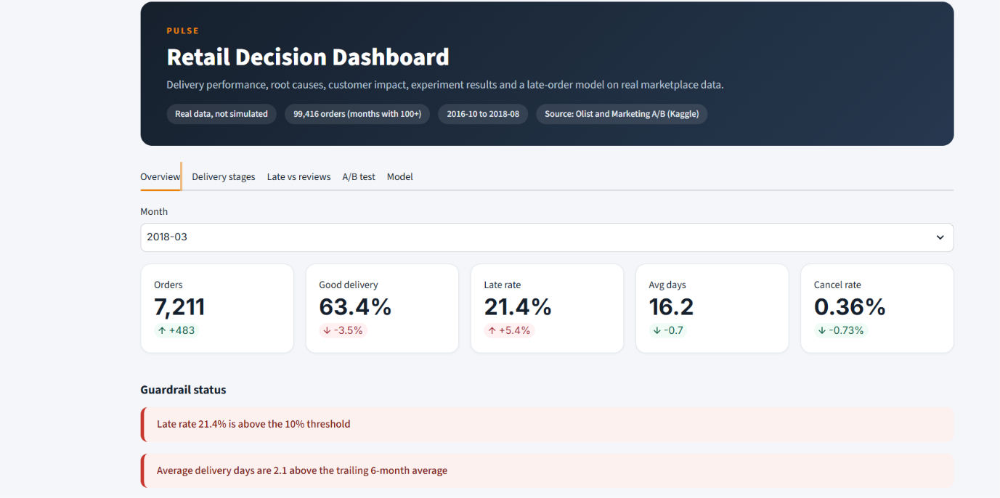
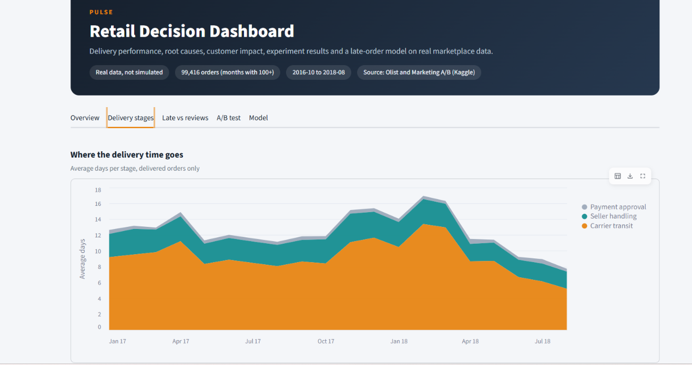
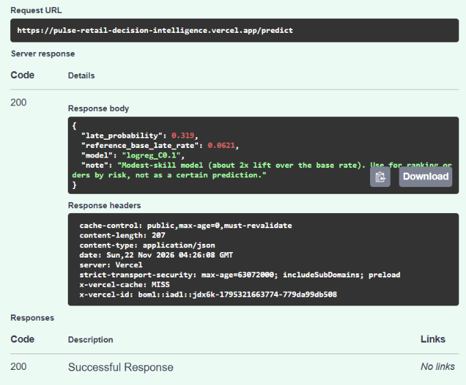
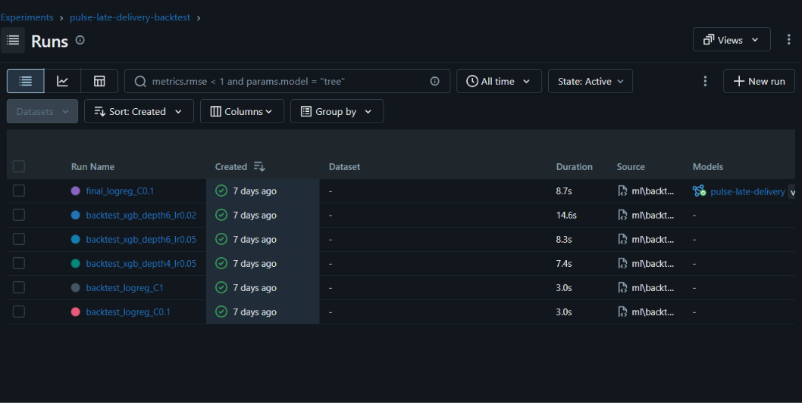

# Pulse: Retail Decision Intelligence Platform


End-to-end analytics and MLOps project on **real marketplace data (no simulated data)**: a tested SQL warehouse, root-cause analysis of delivery delays, an adjusted estimate of how late delivery hurts reviews, an A/B test analysis with a ship/no-ship memo, a late-order prediction model tracked in MLflow, a Dockerized and deployed API with CI, and a monitoring dashboard.

## Live

- **Dashboard (Streamlit Community Cloud):** https://pulse-retail-decision-intelligence-platform-ug5ooadp43lrno7fa9.streamlit.app/
- **Prediction API docs (Vercel, serverless):** https://pulse-retail-decision-intelligence.vercel.app/docs

Both run on free tiers, so the first request after idle time can take several seconds to wake up.

## Screenshots









## Business Questions

1. Are we delivering well, and how do we measure it? (metric spec with a north-star and guardrails)
2. Why did late deliveries spike in some months? (root-cause analysis)
3. Does late delivery actually hurt customer reviews? (adjusted causal estimate)
4. Did a marketing campaign work? (A/B analysis and ship/no-ship memo)
5. Can we flag risky orders at purchase time? (model, API and dashboard)

## Data (Both Public, from Kaggle)

- **Brazilian E-Commerce Public Dataset by Olist:** About 100k orders (2016–2018) across 9 related tables.
- **Marketing A/B Testing:** 588,101 users, ad group vs PSA (control), with a conversion flag.


## Key Findings

| Question | Result |
|---|---|
| Why did late deliveries spike? | The baseline late rate is 4.6%. It reached 14.3% in Nov 2017, 16.0% in Feb 2018 and 21.4% in Mar 2018. Nov 2017 followed a 63% jump in order volume, with slower carrier and seller stages. Feb–Mar 2018 was a broad carrier-leg slowdown of about 4–5 days at normal volume, spread across states, categories and sellers. |
| Does lateness hurt reviews? | Late orders average 2.57 stars vs 4.30 for on-time orders. The estimated effect stays at about -1.7 to -1.8 stars across four regression specifications. Late orders are about 45 percentage points more likely to get a 1–2 star review. Reviews fall sharply once an order is more than 3 days late. |
| Did the ad campaign work? | Conversion was 2.55% for ad vs 1.79% for PSA: +0.77 pp (95% CI 0.59 to 0.94), or +43% relative. Four of 27 segments stay significant after Holm correction. |
| Can late orders be predicted at purchase time? | Modestly. On a held-out May–Aug 2018 window the model reaches PR-AUC 0.128 against a 6.2% base rate (2.1x lift). The top 10% of risk scores contain 21.8% of late orders. |

Full write-ups: [`analysis/rca.md`](analysis/rca.md), [`analysis/causal.md`](analysis/causal.md), [`experiments/memo.md`](experiments/memo.md), [`analysis/metric_spec.md`](analysis/metric_spec.md).

## Architecture

```text
Kaggle CSVs
    |
    v
warehouse/load_raw.py
    |
    v
DuckDB: raw -> staging (clean types) -> marts
    |                                  |
    |                                  +--> fct_orders
    |                                  +--> fct_order_items
    |                                  +--> ml_features
    |
    +---------------------+---------------------+
    |                     |                     |
    v                     v                     v
analysis/              experiments/            ml/
Metrics, RCA,          A/B testing,             Features,
causal analysis        ship/no-ship memo       backtesting,
                                               MLflow tracking
    |                                           |
    v                                           v
dashboard/                                  api/
Streamlit                                  FastAPI + Docker
    |                                           |
    v                                           v
Streamlit Community Cloud                 Vercel Serverless

GitHub Actions:
API tests + Docker image build + container smoke test
```

## What Is Built

- **SQL Warehouse (DuckDB):** Raw, staging and marts layers with CTEs and window functions (`warehouse/`). 11 automated data-quality tests (`tests/test_data_quality.py`).
- **Metrics:** The north-star is on-time orders with a 4–5 star review. Guardrails are late rate, cancellation rate and average delivery days. Definitions and exclusions are in `analysis/metric_spec.md`.
- **Root-Cause Analysis:** Excess-late-order decomposition by customer state, category, seller state, seller and same-state vs cross-state shipping, plus a split of delivery time into approval, seller and carrier stages (`analysis/rca.py`).
- **Causal Analysis:** OLS with robust standard errors, stepwise controls, a dose-response table and a balance check (`analysis/causal.py`).
- **A/B Analysis:** Two-proportion z-test, Newcombe confidence interval, power analysis, and Holm and Bonferroni correction across 27 segment tests (`experiments/ab_test.py`).
- **Model:** Logistic regression vs XGBoost, 5 configurations tracked in MLflow. Selected by a rolling-origin backtest over four monthly folds, scored once on a held-out May–Aug 2018 window, and registered as `pulse-late-delivery` (`ml/`).
- **API:** FastAPI service with `/predict`, `/health` and `/model-info`, input validation, tests and a Dockerfile (`api/`). Deployed serverless on Vercel.
- **CI:** GitHub Actions runs the API tests, builds the Docker image and smoke-tests the container on every push.
- **Dashboard:** Streamlit app with guardrail alerts taken from the metric spec, deployed on Streamlit Community Cloud (`dashboard/`).

## Repository Layout

```text
warehouse/    load_raw.py, run_sql.py, staging/, marts/
analysis/     metric_spec.md, rca.md, causal.md, scripts and outputs
experiments/  ab_test.py, memo.md
ml/           features.sql, train.py, backtest.py
api/          main.py, Dockerfile, model/
dashboard/    app.py, export_data.py, data/
docs/         screenshots
tests/        data-quality tests, API tests
.github/      CI workflow
```

## Run It Yourself

### 1. Set Up the Environment

```powershell
python -m venv .venv
.venv\Scripts\Activate.ps1
pip install -r requirements.txt
```

### 2. Download the Datasets

Download both datasets from Kaggle.

- Unzip Olist into `data/raw/olist/`.
- Place the marketing file into `data/raw/marketing_ab/`.

### 3. Build the Warehouse and Run Data Tests

```powershell
python warehouse/load_raw.py
python warehouse/run_sql.py staging
python warehouse/run_sql.py marts
pytest tests/test_data_quality.py
```

### 4. Run the Analyses

```powershell
python analysis/rca.py
python analysis/causal.py
python experiments/ab_test.py
```

### 5. Train Models and Browse MLflow Runs

```powershell
python ml/backtest.py
mlflow ui --backend-store-uri sqlite:///mlflow.db
```

Open the MLflow UI at:

http://127.0.0.1:5000

### 6. Run the API Using Docker

```powershell
docker compose up --build
```

Open the API documentation:

http://localhost:8080/docs

### 7. Run the Dashboard

```powershell
python dashboard/export_data.py
streamlit run dashboard/app.py
```

## Honesty Notes

- **Causal claims are limited.** The review effect is an adjusted association from observational data, and the root-cause analysis shows where lateness happened, not why.
- **The A/B result is unconfirmed.** Assignment and the intended split are undocumented, so treat it as strong evidence, not proof.
- **The model is modest and the deployment is light.** About 2x lift over the base rate. CI covers the API only, and Vercel runs the API code directly, not the Docker image

## Data Credit

Olist Brazilian E-Commerce Public Dataset and Marketing A/B Testing dataset, both published on Kaggle.
